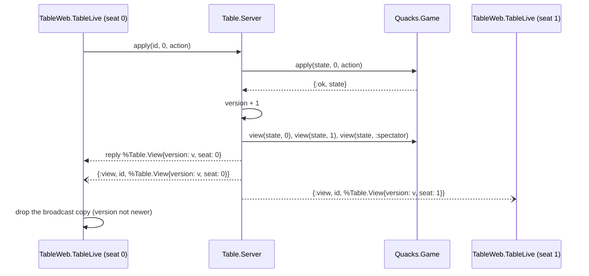
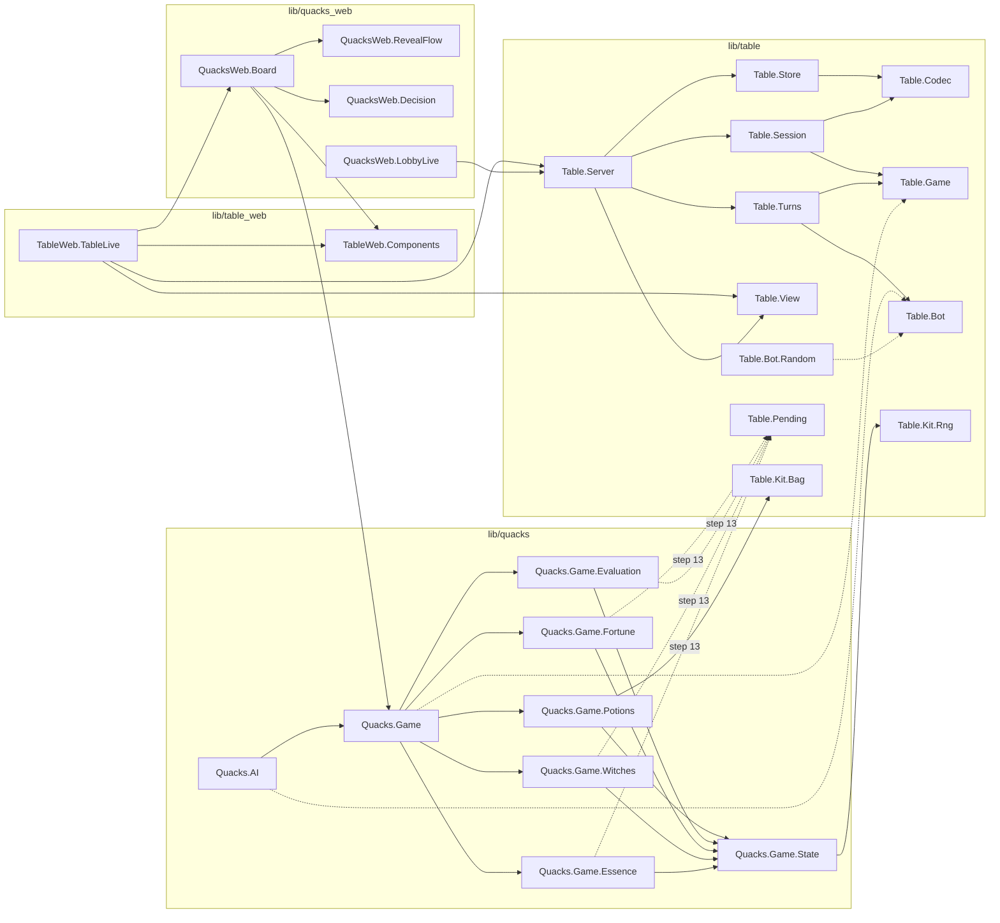

# RFC: `Table.Game` behaviour, generic `Session` and `view/2`

Issue #78, epic #75. Status: proposal, for Nick's review. Builds on
`docs/research/architecture-review.md` (#77); "F1" to "F7" and "G1" to "G10" refer to
that document. Line references are to `c1f8e5c` (staging, 2026-10-16).

## 1. Goal and limits

Every game implements one contract. Then `Table.Session` (replay, undo, bundles),
`Table.Server` (seats, bots, persistence, PubSub), the bots, the property tests and
the gallery work for any game. Quacks is the first game and must not change: every
test, snapshot, scenario and replay bundle stays green at each step.

Out of scope: the lobby's set-up screens (`QuacksWeb.LobbyLive` stays Quacks), the
`Table.Kit` modules (#83, a parallel builder), the rulebook pipeline (#84).

## 2. The contract

```elixir
defmodule Table.Game do
  @type seat :: non_neg_integer
  @type seed :: {integer, integer, integer}
  @type state :: term
  @type action :: term
  @type view :: term

  # -- required -------------------------------------------------------------------
  @callback seat_range() :: Range.t()
  @callback normalise_opts(seats :: pos_integer, opts :: map, seed) ::
              {:ok, map} | {:error, term}
  @callback new(seats :: pos_integer, opts :: map, seed) :: state
  @callback legal_actions(state, seat) :: [action]
  @callback apply(state, seat, action) :: {:ok, state} | {:error, term}
  @callback status(state) :: {:playing, [seat]} | {:over, %{seat => number}}
  @callback view(state, seat | :spectator) :: view

  # -- optional -------------------------------------------------------------------
  @callback pace(state, seat) :: :tick | :lockstep | :together
  @callback lockstep_done?(state, seat, action) :: boolean
  @callback auto_action(state, seat) :: {auto :: action, take_back :: action} | nil
  @callback determinize(view, seat, rng :: :rand.state()) :: {state, :rand.state()}

  @optional_callbacks pace: 2, lockstep_done?: 3, auto_action: 2, determinize: 3
end
```

Invariants every game must keep (the generic property suite in §9 checks them):

1. `new/3` and `apply/3` are pure. All randomness comes from an rng in the state,
   advanced with the `:rand` `_s` API (through `Table.Kit.Rng`, #83).
2. The same `(seats, opts, seed)` and the same list of `{seat, action}` give the same
   state.
3. `apply/3` with an action not in `legal_actions/2` returns `{:error, _}` and does
   not change the state.
4. While `status/1` is `{:playing, active}`, `active` is not empty and is exactly the
   seats with legal actions.
5. `view/2` contains no hidden information for that seat.

Why these choices, against the draft in #78:

- **`new/3` takes the seat count apart from `opts`.** Every game in the plan has
  seats. The server needs the count before the game exists (the lobby), and
  `Quacks.Session` already keeps `players` apart (`lib/quacks/session.ex:11`).
- **`normalise_opts/3` does the checks; `new/3` cannot fail.** The server must check a
  config in the lobby without a game. Today `valid?/2` builds a whole `Quacks.Game` at
  seed `{1, 2, 3}` and rescues `ArgumentError` (`lib/quacks/game_server.ex:1551`).
  The seed is an argument because a Quacks patient pick is valid only for the 3
  patients that the seed deals (`lib/quacks/game_server.ex:1004`). `normalise_opts/3`
  also fills the defaults, so a bundle stores the full options and an old bundle does
  not change when a default changes (today `Session.new/3` stores `game.rules` for the
  same reason, `lib/quacks/session.ex:60-61`).
- **`seat_range/0`** replaces the `players in 1..8` checks in `Quacks.Game.new/1`
  (`lib/quacks/game.ex:391`) and `GameServer.start/5` (`:178`).
- **No `encode/2` and no `describe_action/2`.** The JSON codec in `Quacks.Session`
  (`lib/quacks/session.ex:194-212`) already encodes any atom, tuple, list, map or
  string. The server log names an action by its first atom (`action_name/1`,
  `lib/quacks/game_server.ex:1606-1609`). Both are generic. Add a callback when a
  game needs one.
- **No `simultaneous?/1`.** `pace/2` covers it (§6).

`Quacks.Game` implements the contract with thin adapters over the facade of #79:
`new/3` calls `new(seed: seed, players: seats, ...)`; `status/1` uses `over?/1`,
`score/1` and `legal_actions/2`; `view/2` is §3.

## 3. Decision: `view/2` and PubSub

**Decision: the server pushes one message per seat. Each message is a `Table.View`
envelope with a version number. Pages do not pull.**

```elixir
defmodule Table.View do
  @enforce_keys [:version, :seat, :status, :actions, :view]
  defstruct [:version, :seat, :status, :actions, :view]
  # version: server counter, +1 on every change of the session (also undo and seek)
  # seat:    the seat, or :spectator
  # status:  Table.Game.status/1
  # actions: legal_actions(state, seat); [] for :spectator
  # view:    Table.Game.view(state, seat)
end
```

Topics:

| Topic | Messages | Who subscribes |
|---|---|---|
| `"table:<id>"` | `{:names, ...}`, `{:host, ...}`, `{:rejoined, ...}`, `{:play_again, ...}` | every page of the table |
| `"table:<id>:seat:<n>"` | `{:view, id, %Table.View{}}` | the page of seat `n` |
| `"table:<id>:watch"` | `{:view, id, %Table.View{seat: :spectator}}` | pages without a seat |



Reasons:

- **Pull costs more.** With pull, every change makes every page call the server
  process. The server serialises all calls, and a bot brew makes many changes at once
  (`brew_bots/3`, `lib/quacks/game_server.ex:1388`). Push costs at most 9 `view/2`
  calls (8 seats and the spectators) inside the server, and no extra round trip.
- **The page never holds hidden state.** The envelope has the view and the legal
  actions. The page has nothing to call the engine with, so no template can show a
  hidden hand by mistake (F4).
- **The version fixes the stale check.** Today the page compares `length(game.log)`
  (`lib/quacks_web/live/game_live.ex:625-632`), which is wrong after an undo.
- **Seat changes.** `begin/2` renumbers the seats (`begin_game/1`,
  `lib/quacks/game_server.ex:1477`). The page already asks for its seat again on the
  first game message (`reseat/1`, `lib/quacks_web/live/game_live.ex:822`); it then
  moves its subscription to the new seat topic.

The Quacks view. Quacks has no hidden information between seats; the only secrets are
the future: the `rng` and the order of `fortune_deck`. So:

```elixir
def view(%Quacks.Game{} = g, _seat), do: %{g | rng: nil, fortune_deck: []}
```

The view is still a `%Quacks.Game{}`, so the board and every component keep their
reads (`game.players`, `Game.phase/2`, ...) during the migration. No template reads
`rng` or `fortune_deck` today (only `lib/quacks_web/gallery/fixtures.ex:204`, `:892`,
which build states and do not get views).

Rules for the next games: the board renders only `view` and `actions` from the
envelope. A card game's view replaces hidden cards with a count or with `:hidden`.
The log is part of the view, so the game redacts its log events too (for example
`{:drew, card}` becomes `{:drew, :hidden}` for the other seats).

Bots get the view too: `Table.Bot.decide/4` receives `view(state, seat)`. A game whose
view is lossy (cards, or Quacks' `rng: nil`) implements `determinize/3`, which builds a
full state that agrees with the view, with an rng made from the bot's own rng. Quacks:
the view plus `rng: bot_rng` plus the unseen fortune cards in a shuffled deck. This
keeps `Quacks.AI` working where it simulates with `Game.apply/3`
(`lib/quacks/ai.ex:220-221`), and it can never see a real future draw.

Tests and debug tools still need the full state: `Table.Server.state/1` returns it,
documented as "tests and debug only". `GameHelpers.replace_game/2` uses it.

## 4. Decision: `Session` and the bundle

**Decision: `Table.Session` holds one opaque `opts` map, normalised by the game. The
bundle gets version 2 with a `game` key. Version 1 bundles and game files still load.**

```elixir
defmodule Table.Session do
  defstruct [:game, :seed, :seats, :opts, actions: [], state: nil]
  # game: the module (Quacks.Game); opts: from normalise_opts/3; actions: newest first

  @spec new(module, pos_integer, map, Table.Game.seed) :: {:ok, t} | {:error, term}
  @spec apply(t, seat, action) :: {:ok, t} | {:error, term}
  @spec undo(t) :: t                                  # replay minus the last action
  @spec bundle(t) :: map                              # version 2, JSON-ready
  @spec from_bundle(map, at :: non_neg_integer | nil) :: {:ok, t} | {:error, :invalid}
end
```

Bundle version 2:

```json
{"version": 2, "game": "quacks", "seed": [1, 2, 3], "seats": 4,
 "opts": {"m": [["rules", {"m": [...]}], ["sets", {"m": [...]}], ...]},
 "log": [[0, "draw"], [1, ["buy", {"l": [["green", 1]]}]]]}
```

- `opts` uses the same codec as the actions (atoms, tuples, `l`, `m`, `s`). This codec
  becomes `Table.Codec`; `GameStore` uses it too (opportunity 9).
- `game` is a key in a fixed map in config, `config :quacks, Table, games:
  %{"quacks" => Quacks.Game}`. No `String.to_atom/1` on bundle input.
- Table data stays outside the session, as today: `names`, `bots` and `table`
  (`bundle_of/1` and `file_body/1`, `lib/quacks/game_server.ex:1695-1701`, `:1670-1690`).

Version 1 reader. A bundle with `"version": 1` (no `game`) is Quacks: `seats =
players`; `opts` = today's `sets`, `rules`, `expansions`, `witches`, `patients`
(`lib/quacks/session.ex:147-153`). A game file's table `opts` with the old
`"expansion"` key (`lib/quacks/session.ex:174`) maps to `expansions`. The v1 reader
lives in `Quacks.Game` as `upgrade_bundle/1` (an optional callback of the reader,
not of `Table.Game`), so `Table.Session` knows no Quacks keys.

Write order. One PR adds the v2 reader and keeps writing v1. The next PR writes v2.
Then a rollback to the previous deploy can still read every game file on disk
(staging and production restore all files at boot).

Why one opaque map: today 8 places list the Quacks options (F2). After this, only
`Quacks.Game.normalise_opts/3` knows them.

## 5. Decision: chance

**Decision: randomness stays inside `apply/3`. No explicit chance nodes. Search bots
use `determinize/3`.**

Reasons:

- Quacks draws in the middle of long action chains: the bag
  (`lib/quacks/game/potions.ex:649`), the bonus die
  (`lib/quacks/game/evaluation.ex:125`), the witch deal (`lib/quacks/game/witches.ex:103`)
  and the patients (`lib/quacks/game/essence.ex:44`, `:67`). Chance nodes would split
  each of these actions in two, change the action log and break every bundle.
- ISMCTS does not need chance nodes. Each iteration samples one full world from the
  bot's view (`determinize/3`) and plays it with its own rng. Randomness inside
  `apply/3` is just more of that sampled world.
- The Quacks expert bot computes its odds directly (`Quacks.AI.Odds`,
  `Quacks.AI.Expectimax`); it does not need chance nodes either.

Cost: a generic exact expectimax over chance is not possible. Revisit if a game needs
it (dice-only games); then add an optional `chances(state)` callback for that game.

Requirement for #83: every game draws through `Table.Kit.Rng` and keeps one rng in its
state, so `determinize/3` can swap it.

## 6. Decision: bots and pacing

**Decision: one optional callback, `pace(state, seat)`, tells the server how a seat
acts now. A pure module, `Table.Turns`, owns the bot logic. `Table.Bot` is the bot
behaviour.**

| `pace/2` | Meaning | Quacks today |
|---|---|---|
| `:tick` (default) | a bot seat acts on a timer, one action per tick | round 9 stir, `:patient_choice`, `:essence` |
| `:lockstep` | bots act in step with the humans: each time every acting human did one unit, each bot does one unit; when no human acts, the bots play the rest at once | `held?/1` (`lib/quacks/game_server.ex:1315`): `:potions` in rounds 1-8 |
| `:together` | decide in secret, reveal together: a bot plans its whole part on a copy and the plan waits until no human acts in this phase | `@concurrent` (`:1222`): `:fortune_choice`, `:chip_choice`, `:witch_choice`, `:shopping` |

`lockstep_done?(state, seat, action)` says when a unit ends. Default: after every
action. Quacks: after `:draw` or `:stop` when the seat has no question about the drawn
chip (`mid_draw?/2`, `lib/quacks/game_server.ex:1373`). The "still drawing" test
(`drawing?/2`, `:1426`) becomes `pace(state, seat) == :lockstep and legal_actions(state,
seat) != []`.

`auto_action(state, seat)` replaces the Mandrake code (`auto_return/1`, `:1208`;
`keep_white/2`, `:802`): it returns `{:return_white, :keep}` for a human seat in
`:yellow_choice`. The server applies the first action at once and keeps the session
from before, so `Table.Server.take_back(id, seat)` applies the second action instead.
Bots wait while a take-back is open, as now.

```elixir
defmodule Table.Bot do
  @callback decide(game :: module, view, seat, rng :: :rand.state()) ::
              {action, :rand.state()} | :none
end

defmodule Table.Turns do
  # pure; the server does the effects
  @spec after_action(t, Table.Session.t(), seat, action) :: {t, Table.Session.t(), [effect]}
  @spec on_tick(t, Table.Session.t(), seat) :: {t, Table.Session.t(), [effect]}
  @type effect :: {:tick, seat, delay_ms :: non_neg_integer} | {:acted, seat, action}
end
```

`Quacks.AI` implements `Table.Bot` (it already has the shape,
`lib/quacks/ai/decider.ex:11`). `Table.Bot.Random` (a random legal action) is the
second adapter and the first bot for every new game.

Pre-game set-up (the patient pick, #81): this is an option per seat, not a game step.
`Table.Server.set_seat_opt(id, seat, key, value)` stores it in `opts` and checks it
with `normalise_opts/3`. Quacks keeps `patients: %{seat => id | :random}` as now.

## 7. Decision: `Table.Pending`, and the effect stack later

**Decision: `Table.Pending` is a data model for "these seats must answer". New games
use it from the start. Quacks moves to it last, after the golden bundles (G1) are in,
because its four copies (F5) have different exit rules and the order of their steps
was fixed twice already.**

```elixir
defmodule Table.Pending do
  @moduledoc "A prompt: these seats must answer before the game goes on."
  defstruct kind: nil, order: :together, seats: %{}, then: nil
  # kind:  the game's name for the prompt (:chip_choice, :pass_cards, ...)
  # order: :together (all at once) or :in_turn (one seat after the other, a pass round)
  # seats: %{seat => [action]}, only seats that still answer
  # then:  data the game uses to go on; never a function

  @spec open(kind, %{seat => [action]}, then :: term, keyword) :: t | nil  # nil: nobody
  @spec answered(t, seat, left :: [action]) :: t                          # [] closes the seat
  @spec actions(t, seat) :: [action]
  @spec done?(t) :: boolean
end
```

The game keeps a stack, `pending: [Table.Pending.t()]`, in its state. Its
`legal_actions/2` reads the top prompt. When the top prompt is done, the game pops it
and calls its own `resume(state, then)`. `then` is data, so states still compare with
`==` (the replay tests depend on it, `test/quacks/bundle_test.exs:47`) and a state can
be written to disk.

How it grows into an effect stack (Dominion reactions, Codex, Mage Wars Arena):

- A card that waits for answers pushes a prompt. A reaction to it pushes another
  prompt on top. The top prompt resolves first (last in, first out).
- A timing window ("each player may respond, in turn order, until all pass") is a
  prompt with `order: :in_turn`; each answer that is not a pass opens the window again.
- Effects that resolve later are prompts with no seats and a `then`.

What Quacks would gain: the four `close_*` functions become one rule (F5), and the
phases `:fortune_choice`, `:chip_choice` and `:witch_choice` become `kind`s. That
changes `phase/2`, `GameHelpers.put/3` and the bar's choice code, so it is the last
step (§8, step 13).

## 8. Decision: namespace and layout

**Decision: `Table.*` and `TableWeb.*` in this app, in `lib/table/` and
`lib/table_web/`. No umbrella.**

Reasons:

- One release, one deploy, one `mix precommit`. An umbrella adds a second `mix.exs`,
  config per app and a deps graph, and we have no second release to justify it.
- The thing an umbrella gives, a wall between the table and the games, a test can
  give: `mix table.boundary` (a precommit alias) reads `mix xref graph --format dot`
  and fails when a file in `lib/table*/` has an edge to a file in `lib/quacks*/`.
- The OTP names come from config, not from `Quacks.*` module names:
  `Quacks.GameRegistry`, `Quacks.GameSupervisor` and `Quacks.PubSub`
  (`lib/quacks/application.ex:17-18`) are passed to `Table.Server` as options.

Revisit when a game needs its own deploy or its own release cycle.

## 9. Generic property suite

`Table.GameCase` (test support) runs these properties for any game module:

1. From `new/3`, random legal play never stalls: `status/1` is `:playing` with a
   non-empty `active` list until it is `:over`, and `active` is exactly the seats with
   legal actions.
2. Replay is deterministic: `Table.Session` built from the same seed and actions gives
   an equal state, also through `bundle/1` and JSON.
3. An illegal action changes nothing: `apply/3` returns `{:error, _}` and the state is
   equal.
4. `view/2` hides what it must: the game gives a `hidden(state, seat)` list of terms;
   none of them appears in `view(state, seat)`. For Quacks: the `rng` and the deck
   order.
5. Bots end the game: `Table.Bot.Random` in every seat reaches `:over`.

Quacks keeps its own deeper properties (chip conservation,
`test/quacks/game_test.exs:673-760`).

## 10. Migration plan

Each step is one PR to `staging`, and each one is green: `mix precommit` (with the
snapshots), the golden bundles (G1) and the scenarios. No step changes what a player
sees. The number in brackets is the issue.

| # | PR | What changes | What proves it is safe |
|---|---|---|---|
| 1 | Characterisation tests [#77] | G1 golden bundles and digests; G2 old game file; G3 `assert_game_update/1`; G4 bot restore; G5 mix task smoke tests; G6 bot pacing by outcome; G8 reveal by DOM; G10 Enter key and "New game" | the new tests pass on today's code |
| 2 | Facade [#79] | `Quacks.Game.State` (`@moduledoc false`) gets the helpers of F1; `Quacks.Game` gets the read helpers; web and bots stop calling submodules; fix `seat :: 0..7` | G1; snapshots; `xref` shows no web edge to `Quacks.Game.*` |
| 3 | Drop `expansion` [#79] | remove the field; callers use `expansion?/2` or `expansions`; `decode_opts/1` maps an old `"expansion"` | G1, G2 |
| 4 | `Table.Kit.Rng` and `Bag` [#83, parallel builder] | Quacks draws through the Kit | G1: same chips for the same seed |
| 5 | `Table.Game` behaviour [#80] | `lib/table/game.ex`; `Quacks.Game` adds `seat_range/0`, `normalise_opts/3`, `new/3`, `status/1`, `view/2`; nothing calls them yet | `Table.GameCase` properties 1-4 for Quacks |
| 6 | `Table.Session` and v2 reader [#80] | generic session; `Quacks.Session` becomes a thin wrapper for its callers; reads v1 and v2, writes v1 | G1 (v1 files); `bundle_test.exs` |
| 7 | Write v2 [#80] | bundles and game files are v2; remove `Quacks.Session` | G1, G2; a v2 round-trip test |
| 8 | `Table.Bot` [#80] | `Quacks.AI` implements it; `Table.Bot.Random`; `Quacks.AI.Decider` goes; Quacks `determinize/3`; bots get views | property 5; `bench_test.exs` results the same on its fixed seeds |
| 9 | Views and seat topics [#80] | `Table.View`, version counter, seat topics; `GameLive` reads the envelope; `replace_game/2` uses `Table.Server.state/1` and pushes envelopes | G3; snapshots; `multiplayer_live_test.exs` |
| 10 | `Table.Turns` and `pace/2` [#81] | bot pacing moves out of the server; `auto_action/2`; `take_back/2` replaces `keep_white/2` (keep the old name as an alias for one PR) | G6, G7 by outcome; `game_server_r10_test.exs` without `:sys` |
| 11 | `Table.Server` [#81] | rename; `Table.Store`; set-up options per seat; no `Quacks.*` reference; `mix table.boundary` in precommit | `game_server_test.exs`, `game_store_test.exs`; boundary check |
| 12 | `TableWeb` split [#82] | move generic components to `TableWeb.Components` (no markup change); `TableWeb.TableLive` shell; `QuacksWeb.Board` with `QuacksWeb.RevealFlow` and `QuacksWeb.Decision` (opportunities 5 and 7) | snapshots byte for byte; G8, G10; gallery at 360/392/1280 |
| 13 | Quacks on `Table.Pending` [#78 follow-up] | the four choice sites use one prompt stack | G1; the 4 property tests; scenarios |

Order for the four refactor issues: **#79 → #80 → #81 → #82**, after step 1.
#83 runs in parallel from step 2 and must merge before step 8 (determinize needs
`Table.Kit.Rng`). Do not start #82's component move before step 9: both edit
`GameLive` and would conflict. Step 13 is optional for Quacks and is not needed by the
first new games.

## 11. Target module graph

Solid arrow: calls. Dotted arrow: implements the behaviour.



Notes on the graph:

- `TableWeb.TableLive` finds the board by the game key in config (`"quacks" =>
  QuacksWeb.Board`), not by a compile-time reference. The arrow to `QuacksWeb.Board`
  is a runtime call, so `mix table.boundary` must allow it through config only.
- The engine submodules still call each other (the ring of the review's first graph).
  Those arrows are not drawn. The arrows to `Table.Pending` come in step 13.
- Every other box is an existing module or a module that this RFC names.
- `Table.Kit.Deck`, `Dice`, `Zone` and `PlayingCards` (#83) are not drawn: Quacks
  does not use them.

## 12. Open questions for Nick

1. **Board lookup.** Config map (proposed) or a `board/0` callback on the game? A
   callback puts a web module name inside the engine; we prefer config.
2. **Spectators of finished games.** Should a finished game show the full state (the
   rng is harmless then)? Proposed: no; the view stays the same.
3. **Lobby.** The spell book stays Quacks. When No Thanks! comes, does it get its own
   set-up page, or a generic form from `normalise_opts/3` metadata? Proposed: its own
   page first; generalise after two games.

## 13. Implementation sub-issues

After review, open one issue per step of §10 that is not yet an issue (steps 1, 6-7,
9, 10-11, 13), each with its "safe" column as the done-when.
