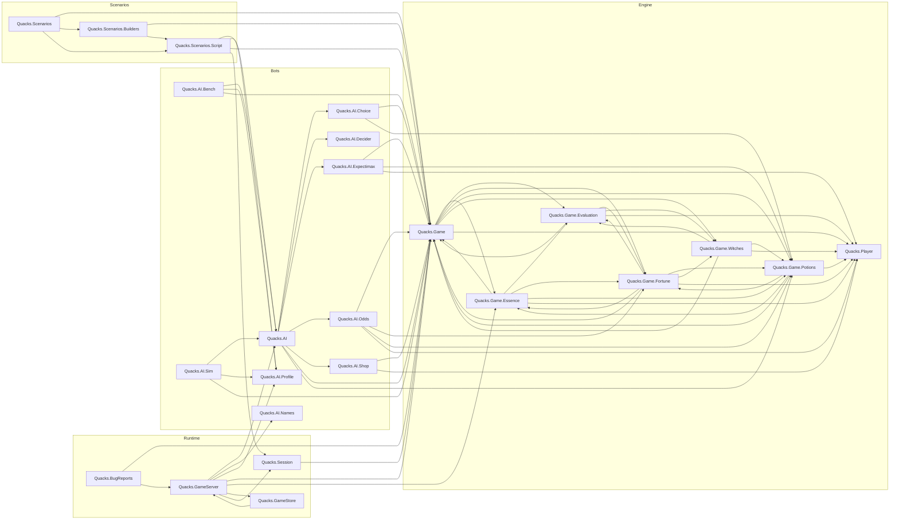
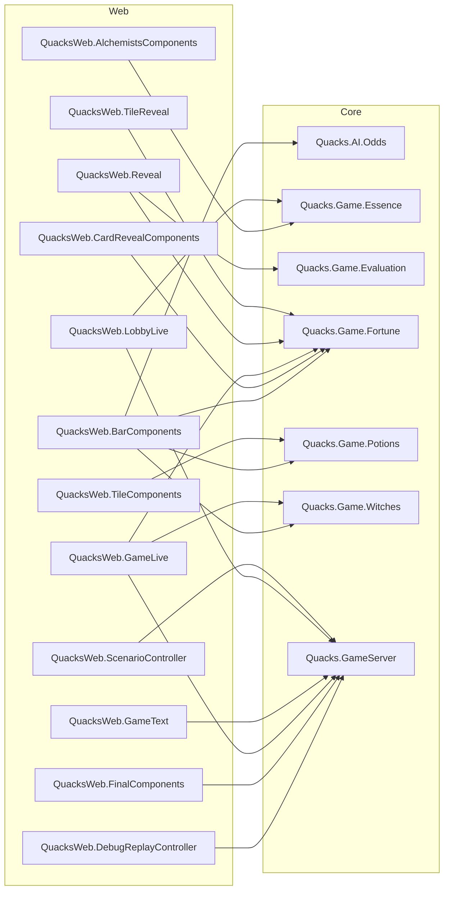

# Architecture review: deep modules for the table platform

Issue #77, epic #75. Branch `arch-rfc`, from `origin/staging` at `c1f8e5c` (2026-10-16).
The design that follows from this review is in `docs/design/table-game.md` (#78).

## 1. Method

We used two skills from [mattpocock/skills](https://github.com/mattpocock/skills)
(commit `49dd158`) as the method:

- `improve-codebase-architecture`: scope on the hot spots, explore, apply the
  **deletion test**, rank the **deepening opportunities**.
- `codebase-design`: the words **module**, **interface**, **depth**, **seam**,
  **adapter**, **leverage** and **locality**, and the rules "the interface is the test
  surface" and "one adapter is a hypothetical seam, two adapters are a real seam".

This review uses those words with those meanings. The domain words come from
`docs/CONTEXT.md` (the skill calls this file `GLOSSARY.md`). The repo has no ADRs.

Scope. The hot spots of the last month (`git log --since=2026-09-15 --name-only -- lib`)
are `QuacksWeb.GameLive` (168 commits), the components (121), `Quacks.Game` (36) and
`Quacks.GameServer` (34). The epic (#75) adds a second direction: what must be generic
so that No Thanks!, Sushi Go! and Hearts can use the same table. The review looks at
both.

Differences from the skill. The skill writes an HTML report to `/tmp` and then asks the
user to pick one candidate. Here the handoff asks for a ranked list with a proposed
interface for each candidate, in the repo. The interfaces are proposals. The RFC
decides them.

## 2. The current module graph

The graph comes from the compiler, not from reading the code:

```sh
mix xref graph --format dot --output xref.dot
```

`xref.dot` has 400 edges between 88 files. We changed each file to its module name and
kept the edges between the modules below. `Quacks.Rules.*` (pure data, 9 modules, no
outgoing edges to these modules), the mix tasks and `Quacks.Application` are not in the
diagram. The script is `docs/research/xref_mermaid.py` (appendix). An arrow means "calls or uses".



The second graph shows the web modules that call past the engine's facade: into a
`Quacks.Game.*` submodule, into `Quacks.AI.Odds`, or into `Quacks.GameServer`. 16 web
modules also call `Quacks.Game` itself. Those edges are not drawn.



What the graphs show:

1. The five `Quacks.Game.*` submodules and `Quacks.Game` call each other in a ring
   (`mix xref graph --format stats` counts 19 cycles). The ring is not a problem by
   itself, because the six modules are one engine. The problem is that the ring has
   no wall: the bots and the web call into it at many points (second graph).
2. `Quacks.GameServer` calls `Quacks.Game.Essence` (`lib/quacks/game_server.ex:248`,
   `:1004`, `:1730`) and `Quacks.AI` directly. A generic table server must not.
3. `Quacks.GameStore` and `Quacks.GameServer` call each other.
4. `Quacks.AI.Decider` is the only seam with a behaviour, and it has one adapter
   (`Quacks.AI`). By the skill's rule it is a hypothetical seam today.

## 3. Findings, with the deletion test

### F1. `Quacks.Game` is deep inside, but its interface is wide

The real interface is about 8 functions: `new/1` (`lib/quacks/game.ex:385`),
`legal_actions/2` (`:567`), `apply/3` (`:697`), `phase/2` (`:528`), `over?/1`
(`:515`), `score/1` (`:519`), plus read helpers. But the module also exports the
helpers that only its submodules need: `player/2` (`:1014`), `update_player/3`
(`:1017`), `record/2,3` (`:1021`, `:1024`), `take_supply/2` (`:1038`),
`return_supply/2` (`:1044`), `add_from_supply/3` (`:1051`), `give_black/2` (`:1066`),
`effect/4` (`:1082`), `move_droplet/3` (`:970`), `turn_order/1` (`:1086`),
`to_shop/1` (`:1096`), `done_buying/2` (`:1105`), `start_round/1` (`:875`),
`rats/1` (`:884`), `buys/2` (`:931`), `buy/4` (`:951`).

Callers outside the engine use some of them:

- `Game.update_player/3`: `QuacksWeb.Gallery.Fixtures`, `QuacksWeb.Reveal`.
- `Game.record/2`, `Game.effect/4`: `QuacksWeb.Gallery.Fixtures`.
- `Game.turn_order/1`: `QuacksWeb.GameLive`, `QuacksWeb.Reveal`, the fixtures.
- Submodule reads from the web: `Fortune.reveals/1`, `Fortune.reveal_card?/1`,
  `Fortune.choice_card?/1`, `Fortune.flea_block/1`, `Fortune.upgrade/1`,
  `Fortune.explode_above/1`, `Potions.explode_above/2` (`lib/quacks/game/potions.ex:357`),
  `Witches.upgrade/1`, `Evaluation.targets/2`, `Essence.count/2`, `Essence.dealt/1`.
- From the bots: `Potions.explode_above/2` (`lib/quacks/ai.ex:206`,
  `lib/quacks/ai/choice.ex:151`, `lib/quacks/ai/expectimax.ex:84`,
  `lib/quacks/ai/odds.ex:59`) and `Fortune.safe_draw?/2` (`lib/quacks/ai/odds.ex:57`).

Deletion test on the helpers as interface: if we remove them from the interface, no
complexity comes back in the callers, because the callers only need reads ("what is
the white limit for this seat now?"). So the helpers are internal seams that leak.

Also: the legacy `expansion` field (`lib/quacks/game.ex:128`, set at `:429`) sits next
to `expansions`. `Quacks.Session` copies both (`lib/quacks/session.ex:14-15`). The web
still reads `game.expansion` in 9 places, for example
`lib/quacks_web/components/shop_components.ex:46` and
`lib/quacks_web/components/panel_components.ex:309`. The type `seat :: 0..4`
(`lib/quacks/game.ex:134`) is wrong: the game has 1 to 8 players.

### F2. `Quacks.Session` and the table repeat the game's options

`Quacks.Session` keeps `sets`, `rules`, `expansion`, `expansions`, `witches` and
`patients` as its own fields (`lib/quacks/session.ex:10-19`) and lists them again in
`@game_opts` (`:35`), in `undo/1` (`:88-94`), in `bundle/1` (`:122-128`), in
`from_bundle/2` (`:147-153`), in `encode_opts/1` (`:170-178`) and in `decode_opts/1`
(`:184-191`). `Quacks.GameServer` keeps a third copy as a keyword list (`opts`) and
lists the same keys in `create/3` (`lib/quacks/game_server.ex:205`) and
`start_debug/2` (`:322-327`). To add one option, a developer changes about 8 places.

Deletion test on `Quacks.Session`: if we delete it, replay, undo and the bundle codec
come back in `GameServer`, `Scenarios.Script`, `BugReports` and the tests. So the module
earns its keep. Its interface is too wide only because the options are not opaque.

The JSON codec for actions (`encode/1`, `decode/1`, `lib/quacks/session.ex:194-212`)
is already game-agnostic. It is private, so `GameStore` and `GameServer` go through
`Session.encode_opts/1` for it.

### F3. The table server mixes four jobs

`Quacks.GameServer` (1,747 lines) holds:

1. The table: lobby, seats, host, presence, rejoin, colours, names, play again.
2. Persistence and debug tables: the game file, `start_from_bundle/2`, `seek/2`.
3. Bot pacing: `held?/1` (`:1315`), `step_bots/4` (`:1322`), `bot_step/4` (`:1355`),
   `brew_bots/3` (`:1388`), `next_brew/1` (`:1405`), `plan/2` (`:1260`), `flush/1`
   (`:1235`), the `@concurrent` phase list (`:1222`) and `humans_deciding?/2`
   (`:1225`). About 250 lines. Each one reads Quacks phases: `:potions`, round 9,
   `:yellow_choice`, `:blue_choice`, `:chip_choice`, `:essence_offer`
   (`mid_draw?/2` `:1373`, `drawing?/2` `:1426`).
4. Quacks rules: the Mandrake auto-answer (`auto_return/1` `:1208`, `keep_white/2`
   `:802`), patient picks (`:996-1011`, `:238-250`) and the option check `valid?/2`
   (`:1551`), which builds a full `Quacks.Game` at seed `{1, 2, 3}` to check a config.

Job 3 is pure logic over `(session, bots, rngs, humans)`. It does not need a process.
But today the tests can only reach it through a process and `:sys.get_state/1` (see
§5.3). This is the strongest testability problem in the repo.

### F4. Every page receives the whole game

The server broadcasts `{:game, id, game}` with the full `%Quacks.Game{}`
(`lib/quacks/game_server.ex:773`, `:1126`, `:1440`). The struct holds the `rng`
(it predicts every future draw) and the `fortune_deck` order. No template reads them
today (`grep` finds them only in `lib/quacks_web/gallery/fixtures.ex:204`, `:892`).
So there is no leak to a browser now. But nothing stops one: one careless template
line can show a hidden hand in a card game.

Each page then recomputes its own seat's part: `put_game/2`
(`lib/quacks_web/live/game_live.ex:2324`) calls `Game.legal_actions/2` and
`Game.phase/2` for the seat. It drops stale broadcasts by comparing `length(game.log)`
(`lib/quacks_web/live/game_live.ex:625-632`). That check is wrong after an undo,
because an undo makes the log shorter. It works today only because undo is solo
(`lib/quacks/game_server.ex:814`) and the reply sets the game.

### F5. The four "open choices, close choices" copies

Four modules use the same algorithm: put the game in phase P, put every asked seat in
P, and after each answer close the seats that have no choice left; when no seat is in
P, go on.

- Fortune: `open_choices/1` and `close_choices/1` (`lib/quacks/game/fortune.ex:678`,
  `:704`).
- Evaluation: `run/1` and `close_choices/1` (`lib/quacks/game/evaluation.ex:55-60`,
  `:80`).
- Witches: `open_gold/1` and `close_gold/1` (`lib/quacks/game/witches.ex:186`, `:198`).
- Essence: `open/1` and `close/1` (`lib/quacks/game/essence.ex:280`, `:263`).

Each copy has small differences (Fortune sends a seat back to `:potions` or `:done`;
Witches asks only seats with a legal action). The deletion test: one shared module
would concentrate the "who still answers, when do we go on" logic. The order of these
steps changed twice already (round 18 and round 35, `lib/quacks/game.ex:76-78`).

### F6. `QuacksWeb.GameLive` is three modules in one

`lib/quacks_web/live/game_live.ex` has 3,508 lines now (the issue said 3,328) and
371 function clauses. It holds:

1. The table shell: mount, seats, rejoin, rename, colour, undo, seek, bug report,
   play again, flash messages (`:140-720`).
2. One `render/1` of about 1,035 lines (`:1097-2132`).
3. The reveal and tips state machine: `open_reveal/1` to `book_beats/2`, about 60
   functions (`:2442-3300`), with timers (`{:reveal_tick, ref}`,
   `{:reveal_settle, ref}`) and per-browser state in `@reveal`.
4. The decision model: which dialog, which bar choice, which Enter action
   (`decide/4` `:2896`, `bar_choice/4` `:2913`, `decision/3` `:3439`,
   `enter_action/1` `:887`).

`QuacksWeb.Reveal`, `QuacksWeb.TileReveal` and `QuacksWeb.Replay` are already pure
(good). But the state machine that drives them over time is private in the LiveView.
The tests reach it through `:sys.get_state(view.pid).socket.assigns.reveal`
(§5.3).

### F7. Bots: the seat is game-agnostic, the brain is not

`Quacks.AI.Decider` (`lib/quacks/ai/decider.ex:11`) types its callback with
`Quacks.Game.t()`. `Quacks.AI.Bench` and `Quacks.AI.Sim` play Quacks only. For the
epic, the generic part is "a bot is `(state, seat, rng) -> {action, rng} | :none`"
and the generic random-legal bot. The Quacks brain stays Quacks.

## 4. Ranked deepening opportunities

Value: how much leverage and locality it gives, and how much the epic needs it.
Cost: size of the change and risk to the tests. 1 = low, 3 = high.

| # | Opportunity | Value | Cost | Strength | Issue |
|---|---|---|---|---|---|
| 1 | Narrow the `Quacks.Game` facade | 3 | 1 | Strong | #79 |
| 2 | Pure bot pacing module out of `GameServer` | 3 | 2 | Strong | #81 |
| 3 | Generic `Table.Session` with one opaque `opts` | 3 | 2 | Strong | #80 |
| 4 | Seat view envelope and versioned updates | 3 | 2 | Strong | #80 |
| 5 | Reveal flow as a pure module | 2 | 2 | Worth exploring | #82 |
| 6 | `Table.Pending` for concurrent choices | 2 | 2 | Worth exploring | #78 |
| 7 | Decision model as a pure module | 2 | 1 | Worth exploring | #82 |
| 8 | `Table.Bot` behaviour and random-legal bot | 2 | 1 | Worth exploring | #80 |
| 9 | Shared codec for bundles and game files | 1 | 1 | Speculative | #80 |

### 1. Narrow the `Quacks.Game` facade (F1)

- **Files**: `lib/quacks/game.ex`, `lib/quacks/game/*.ex`, the web and bot callers
  listed in F1.
- **Solution**: move the helpers to `Quacks.Game.State` (`@moduledoc false`). Add the
  read helpers that callers need to `Quacks.Game`, so no caller outside
  `lib/quacks/game*` names a submodule. Remove `expansion`.
- **Proposed interface**:

  ```elixir
  # Quacks.Game: the contract
  new(opts) :: t                      # later: Table.Game.new/3, see the RFC
  legal_actions(t, seat) :: [action]
  apply(t, seat, action) :: {:ok, t} | {:error, {:illegal_action, action, phase}}
  phase(t, seat) :: phase | Player.phase() | :droplet_choice
  over?(t) :: boolean
  score(t) :: %{seat => non_neg_integer}

  # Quacks.Game: reads for the board and the bots
  player(t, seat) :: Player.t()
  turn_order(t) :: [seat]
  white_limit(t, seat) :: pos_integer          # today Potions.explode_above/2
  safe_draw?(t, seat) :: boolean               # today Fortune.safe_draw?/2
  card_reveals(t) :: [...]                     # today Fortune.reveals/1 and friends
  black_targets(t, seat) :: [seat]             # today Evaluation.targets/2
  essence_reach(t, seat) :: {0..10, map}       # today Essence.count/2
  dealt_patients(seed) :: [Alchemists.id()]    # today Essence.dealt/1
  ```

- **Benefits**: locality: a change inside the engine cannot break the web if the reads
  stay. Leverage: one place to learn what the board may ask. Tests: engine tests
  already go through `apply/3` (32 test files call `legal_actions/2`); only 18 test
  lines call the internal helpers (`Game.update_player`, `Game.record`,
  `Game.start_round`, ...), and they can call `Quacks.Game.State` or `GameHelpers`.
- **Gallery fixtures** (`QuacksWeb.Gallery.Fixtures`) build states with the internal
  helpers. They are test support in `lib/`. They may call `Quacks.Game.State`; mark
  that as the one allowed exception.

### 2. Pure bot pacing out of `GameServer` (F3)

- **Files**: `lib/quacks/game_server.ex:1203-1441`.
- **Solution**: a pure module that owns "which bot acts now, and how". The server
  calls it after every change and does the side effects it returns (timers,
  broadcasts, log lines).
- **Proposed interface** (the RFC names it `Table.Turns`):

  ```elixir
  @spec after_action(Turns.t, Session.t, seat, action) :: {Turns.t, Session.t, [effect]}
  @spec on_tick(Turns.t, Session.t, seat) :: {Turns.t, Session.t, [effect]}
  @type effect :: {:tick, seat, delay_ms} | {:bot_acted, seat, action, engine_us}
  ```

  `Turns.t` holds the bot seats, their rngs, `queued`, `drawn` and the pending ticks.
  The game says how a phase is paced with one callback (`pace/2` in the RFC), so the
  module names no Quacks phase.
- **Benefits**: the interface is the test surface: a test gives a session and an
  action and checks the session and the effects. No process, no `:sys`. Locality: the
  three bot paths (tick, lockstep brew, reveal together) sit in one module.
- **Dependency category**: in-process. No adapter needed.

### 3. Generic `Table.Session` with one opaque `opts` (F2)

- **Solution**: `Table.Session` holds `game` (the module), `seed`, `seats`, `opts` (one
  map that the game normalises), `actions` and `state`. The game owns its options.
- **Proposed interface**: see `docs/design/table-game.md` §4.
- **Benefits**: to add a Quacks option, change only `Quacks.Game`. Undo, replay and
  bundles work for every game. The "add an option in 8 places" problem goes away.

### 4. Seat view envelope and versioned updates (F4)

- **Solution**: the server sends each page a `Table.View` for its seat: the game's
  `view/2`, the seat's legal actions, the status and a version number. Hidden
  information never leaves the server process.
- **Proposed interface**: see `docs/design/table-game.md` §3.
- **Benefits**: a template cannot show what the page does not have. The version
  fixes the stale-update check (F4). The page stops calling the engine.

### 5. Reveal flow as a pure module (F6, part 3)

- **Solution**: move the reveal and tips transitions out of `GameLive` into a pure
  `QuacksWeb.RevealFlow` with `start/2`, `next/1`, `skip/1`, `tick/2` that return the
  new flow and the timers to start. `GameLive` keeps only `Process.send_after/3`.
- **Benefits**: tests call the module, not `:sys.get_state(view.pid)`. `#82` gets a
  smaller shell. The reveal is Quacks-specific; it goes into the Quacks board, not into
  `TableWeb.TableLive`.

### 6. `Table.Pending` for concurrent choices (F5)

- **Solution**: one module for "these seats must answer; go on when all did". First
  as a shared function over the current fields (no state change), later as data on a
  stack for effect stacks. See `docs/design/table-game.md` §7.
- **Benefits**: locality for the step order that broke in rounds 18 and 35. New games
  (Sushi Go! drafting, Hearts passing) get it for free.

### 7. Decision model as a pure module (F6, part 4)

- **Solution**: `QuacksWeb.Decision.from(actions, phase, me, assigns)` returns
  `%{decision, bar_choice, actions, enter_action, stop_slot}`. Today `put_game/2`
  computes these with about 25 private functions.
- **Benefits**: the Enter key paths (`lib/quacks_web/live/game_live.ex:879-908`) have
  no test coverage today. A pure module is easy to test with a table of cases.

### 8. `Table.Bot` behaviour and random-legal bot (F7)

- **Solution**: `Table.Bot.decide(game_module, state, seat, rng)`. `Quacks.AI` is the
  first adapter, `Table.Bot.Random` the second. With two adapters the seam is real.
- **Benefits**: the property suite and the server can play any game with bots.

### 9. Shared codec (F2)

- **Solution**: make the private JSON codec in `Quacks.Session` a module
  (`Table.Codec`). `GameStore` and `start_from_bundle/2` use it.
- **Note**: 3 of its clauses have no test (§5.2). Low value until a second game has
  maps or strings in its actions.

### Top recommendation

Start with **#1 (the facade)**. It is cheap, it has no behaviour change, and every
other step needs it: the RFC's `Table.Game` callbacks wrap exactly this facade. Do the
characterisation tests of §5.4 in the same week, because #2, #3 and #4 change the
places the tests touch today.

## 5. Test trust audit

### 5.1 The suite today

`mix test --cover` on `c1f8e5c`: 1,725 tests, 23 doctests, 5 properties, 0 failures,
43.5 s. 465 snapshot tests are excluded by default (`test/test_helper.exs:3`);
`mix precommit` runs them. Total line coverage: **92.07 %**.

Most LiveView tests check outcomes: 1,424 `has_element?` calls against 105
`render(...) =~` text checks. The engine has 4 property tests that play random legal
games (`test/quacks/game_test.exs:673`, `test/quacks/herb_witches_test.exs:381`,
`test/quacks/ingredient_sets_test.exs:414`, `test/quacks/ai_test.exs:252`) plus one for
the expectimax bot.

### 5.2 Coverage of the modules that #79 to #82 change

| Module | Line coverage | Refactor | Uncovered lines that matter |
|---|---|---|---|
| `Quacks.Game` | 99.22 % | #79 | none that matter |
| `Quacks.Game.Fortune` | 94.40 % | #79, Pending | `choice_gains/2` for 9 card answers (`fortune.ex:228-245`): the card log text, not the rules |
| `Quacks.Session` | 95.89 % | #80 | the codec for `MapSet` and strings (`session.ex:199`, `:204`, `:211`) |
| `Quacks.GameServer` | 95.54 % | #81 | bot rng restore from a game file (`:398`); a bot tick that brews and must broadcast (`:1437-1441`); a bot seat in `step_bots/4` (`:1335`); play again with Alchemists and 2+ humans (`:1451-1452`); the step and brew budgets (`:1353`, `:1389`) |
| `Quacks.GameStore` | 85.71 % | #81 | file errors |
| `Quacks.AI` | 97.03 % | #80 | fallbacks (`ai.ex:256`, `:282`) |
| `Quacks.AI.Stall` | 0 % | #80 | only used by the mix tasks |
| mix tasks (`quacks.bench`, `quacks.sim`, `quacks.tune`, `quacks.replay`) | 0 % | #80 | all; they call `Quacks.Game` and `Quacks.AI` directly |
| `QuacksWeb.GameLive` | 90.16 % | #80, #82 | "New game" (`game_live.ex:378-381`, it calls `GameServer.start/5` with Quacks options); the Enter key (`:879-908`); the auto reveal timer (`:2814-2821`); error flashes when the server is gone (`:265`, `:293`, `:303`, ...) |
| `QuacksWeb.BarComponents` | 87.93 % | #82 | |
| `QuacksWeb.RevealComponents` | 83.42 % | #82 | |
| `QuacksWeb.GameText` | 79.74 % | #79 | |

Caution: `GameLive.preview/3` (`:2225`) shows as uncovered because the snapshot tests
are excluded from the cover run. Line coverage also says nothing about the order of
steps, which is where the engine bugs were.

### 5.3 Tests that check the implementation, not the outcome

These tests will fail in the refactors even when the behaviour stays the same:

1. **Server state through `:sys`.** `test/quacks/game_server_r10_test.exs:23`, `:50`,
   `:74`, `:87`, `:100`, `:120`, `:138` read or write `queued` and `bot_ticks`;
   `test/quacks/game_server_test.exs:446`, `:503`, `:518` read `bot_ticks`;
   `test/quacks/game_store_test.exs:26-262` reads `write_timer`, `expire_timer` and
   `store`, and writes `session`. #81 moves exactly these fields.
2. **`replace_game/2`** (`test/support/game_helpers.ex:92-97`): 145 calls in 24 files.
   It writes `st.session.game` with `:sys.replace_state/2` and broadcasts
   `{:game, id, game}` itself. The session's `actions` then do not replay to its game,
   so undo or a bundle in such a test gives another game. Good news: it is one helper,
   so #80 changes one place.
3. **LiveView assigns through `:sys`.** `test/quacks_web/live/results_stage_test.exs:290`,
   `:387`, `:420`, `:458`, `:476` and
   `test/quacks_web/live/rubies_and_witches_test.exs:163` read `socket.assigns.reveal`.
   #82 moves `@reveal`.
4. **The broadcast shape.** 6 places assert `{:game, _, _}` messages
   (`test/quacks/game_server_test.exs`, `test/quacks/debug_replay_test.exs`,
   `test/quacks_web/live/reconnect_and_rejoin_test.exs`,
   `test/quacks_web/live/motion_hooks_test.exs`). #80 changes the message.
5. **Self-consistent replay checks.** `test/quacks/bundle_test.exs:47` and
   `test/quacks/game_test.exs:266`, `:285`, `:547` compare two runs of the same code.
   They prove that replay is deterministic. They cannot prove that a refactor keeps
   the same draws, because both runs change together. There is no stored bundle in the
   repo (no `test/fixtures`). #83 ("the same seed gives the same chips") and #80 ("old
   bundles still load") have no test today.
6. **States built by field writes.** `GameHelpers.put/3` and `Gallery.Fixtures` write
   struct fields directly. They can make states that the engine cannot reach. This is
   acceptable for the engine's own tests. It is a risk when Pending changes which
   fields hold a choice: then `put(phase: :chip_choice)` makes a broken state.

### 5.4 Minimum characterisation tests before each refactor

Add these on the current code, see them pass, then refactor.

**Before #79 (facade) and #83 (Kit):**

- **G1. Golden bundles.** Commit 6 bundles in `test/fixtures/bundles/`, made by bots
  on today's code: solo base game; 4 players with `supply: :limited`; Herb Witches with
  `pot_side: :back`; Alchemists with patient picks; 8 players with both expansions and
  Sets 5/6; one real bug-report bundle (version 1). Next to each, a digest: final
  `score/1`, `round`, `phase`, log length, and `:erlang.phash2/1` of each seat's bag
  and pot. The test loads each bundle with `Session.from_bundle/1` and compares the
  digest. This is the only test that catches a change in the random stream.
- **G2. Old game file.** Commit one `GameStore` file written today (it has the
  `"expansion"` key through `Session.encode_opts/1`, `lib/quacks/session.ex:174`). The
  test restores it with `start_from_bundle(bundle, restore: true)` and plays one
  action. #79 removes `expansion`; this test proves old files still load.

**Before #80 (Session, view, bots):**

- **G3. One helper for updates.** Change the 6 `{:game, _, _}` asserts to a helper
  `assert_game_update(id)` in `GameHelpers`. Then #80 changes one helper.
- **G4. Bot restore.** A stored playing game with 2 bots restores and the bots play on
  the same actions as the game that was not stored (covers `game_server.ex:398`).
- **G5. Mix tasks smoke test.** Run `mix quacks.sim` and `mix quacks.replay` once each
  from a test (`Mix.Tasks.Quacks.Sim.run/1`, 1 short game). The mix tasks have 0 %
  coverage; `Quacks.AI.Sim` and `Quacks.AI.Bench` have tests
  (`test/quacks/ai_test.exs:262`, `test/quacks/ai/bench_test.exs:16`), the tasks do not.

**Before #81 (server):**

- **G6. Bot pacing by outcome.** Replace the `:sys` reads of §5.3 item 1 with checks
  on the log the pages receive: after one human draw, each brewing bot drew exactly
  once; after the last human stop, every bot is done; in `:shopping`, no bot action is
  in the log before the last human `:end_round`; a queued plan that becomes illegal
  (limited supply) makes the bot decide again. Keep the `game_store_test.exs` timer
  tests, but read the timers through a small `GameServer` debug function, not the
  state shape.
- **G7. Mandrake take-back.** Already covered by outcome:
  `test/quacks/game_server_r10_test.exs:130-144` and
  `test/quacks_web/live/bar_choices_test.exs:516`. Keep them unchanged through #81;
  they are the check for `auto_action/2`.

**Before #82 (LiveView split):**

- **G8. Reveal by DOM.** Rewrite the 6 `socket.assigns.reveal` reads to read the
  overlay: slide index as a `data-` attribute, the tick through
  `send(view.pid, ...)` with a ref read from the DOM. Add the attribute first.
- **G9. Full snapshot run green** (`mix test --only snapshot`) on the base commit, and
  a snapshot for the waiting panel and the game-over screen if the gallery has none.
- **G10. Enter key and "New game".** One LiveView test each
  (`game_live.ex:879-908`, `:378-381`).

### 5.5 What the HTML snapshots do not catch

The snapshots (`test/quacks_web/ui_snapshot_test.exs`, 464 files under
`test/snapshots/`) compare the HTML of each gallery story and scenario step. They do
not catch:

- **CSS.** A change in `assets/css/app.css` or in a Tailwind class's meaning changes no
  HTML. A wrong class name that Tailwind does not generate also passes.
- **Layout and pixels.** Overlap, overflow and wrapping at 360, 392 and 1280 px.
- **JavaScript.** Hooks, motion (`PotMotion`), sounds and haptics.
- **Time and events.** The gallery frame renders one moment; clicks do nothing
  (`lib/quacks_web/live/gallery_frame_live.ex`). Reveal timers, server pushes and the
  order of updates are not in a snapshot.
- **Unreachable states.** Fixtures can build states the engine never reaches (§5.3
  item 6).

The parallel `visual-regress` builder adds pixel regression for the first three. The
LiveView tests cover events. Nothing covers the order of updates between two browsers
except `multiplayer_live_test.exs`.

## 6. Should we vendor the skills into `.claude/skills/`?

Recommendation: **vendor `codebase-design` only. Do not vendor
`improve-codebase-architecture`.** We did not vendor anything in this branch.

- `codebase-design` gives the words this review and the RFC use. A builder in a
  worktree, a cloud session or a new contributor gets the same words only if the skill
  is in the repo. It is 4 small files. Pin the commit (`49dd158`) in a comment so an
  update is a choice.
- `improve-codebase-architecture` is a one-time, interactive command. It has
  `disable-model-invocation: true`, writes an HTML file to `/tmp`, opens a browser and
  then starts a grilling loop. Its output is this document. Run it again from the
  global install when we need a new review.
- Both skills are already in `~/.claude/skills/` on Nick's machine, so local sessions
  have them now. Vendoring matters only for sessions without that folder.
- If we vendor, map `GLOSSARY.md` to `docs/CONTEXT.md` in one line at the top of the
  vendored `SKILL.md`, because the skills look for `GLOSSARY.md`.

## Appendix: graph script

Run from the repo root:

```sh
mix xref graph --format dot --output xref.dot
python3 docs/research/xref_mermaid.py xref.dot core   # the first graph
python3 docs/research/xref_mermaid.py xref.dot web    # the second graph
```

The script reads each `"a.ex" -> "b.ex"` edge, changes each file to the `defmodule`
name in it, and prints the edges between the listed modules as a Mermaid `flowchart`.
Run it again after a refactor to get the new graph.
